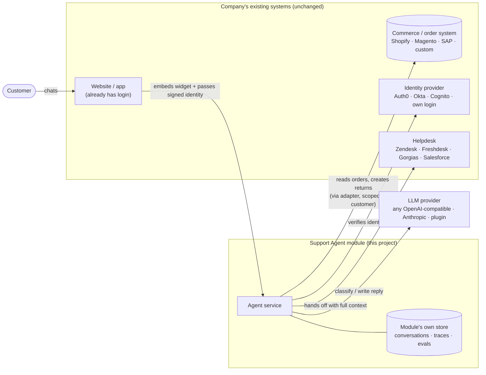
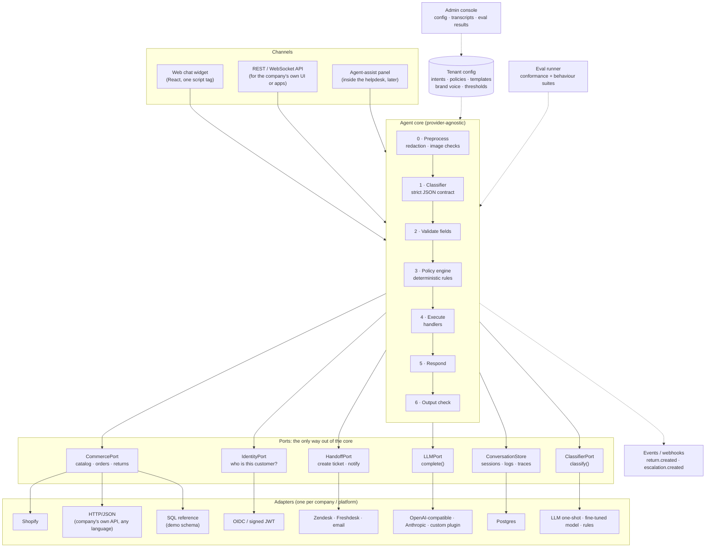
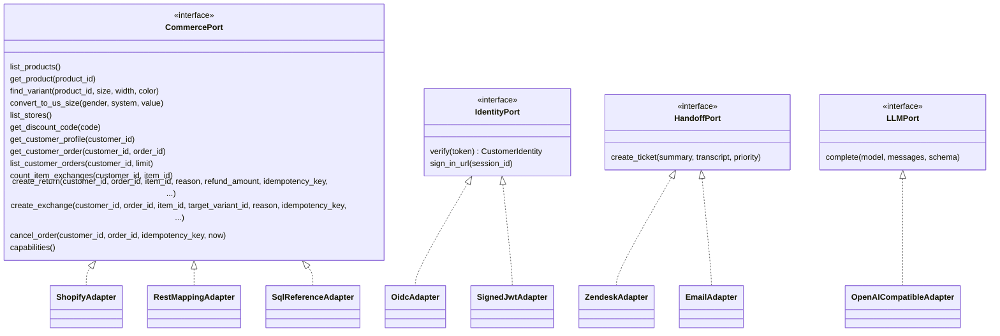
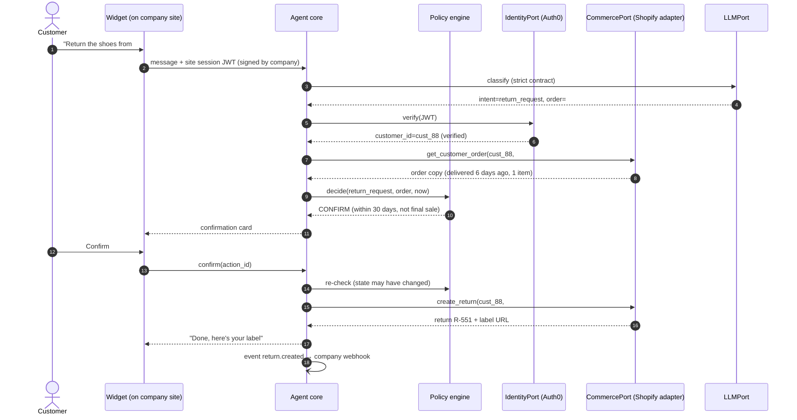
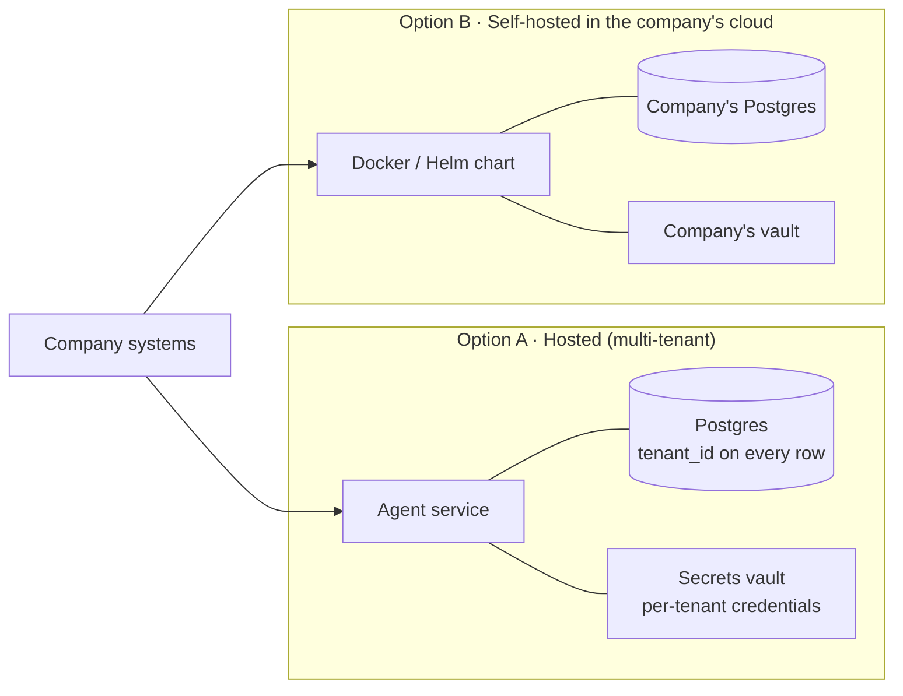

# Architecture: a plug-and-play support agent

**Goal:** a company that already runs a store, an order system, customer accounts and a helpdesk can add this agent **without moving its data or changing its systems**. The company connects the agent to the systems it already has, sets its own policies, and puts a chat widget on its site.

The core idea: **the agent never touches a database or a vendor API directly.** It can only call a small, fixed set of functions, published as **contracts** ("ports", in [`app/ports/`](../app/ports/)). Each company plugs in an **adapter** that implements a contract against its own systems: Shopify, Salesforce, a custom REST API, or its own SQL database. Ports exist today for company data, the classifier, the LLM, identity and helpdesk handoff; §2 and §9 say which adapters are built.

---

## 1. The big picture



**What the module owns:** conversations, pipeline traces, parked requests, escalation records and eval results.

**What it never owns:** the company's products, customers, orders or refunds. These are read live through adapters, and changed only through the company's own APIs.

---

## 2. Inside the module



| Part | Where | Status |
|---|---|---|
| Pipeline | [`app/agent/`](../app/agent/) | Done: imports no adapter, database or vendor SDK (enforced by `tests/test_agent_boundary.py`) |
| Company data | `CommercePort` ([`app/ports/commerce.py`](../app/ports/commerce.py)) | Done: `sql_reference` (demo schema) and `http_json` (any system speaking the JSON-over-HTTP contract). Shopify: planned |
| Injection guard | [`app/agent/injection_guard.py`](../app/agent/injection_guard.py) + [`agent_config/injection_guard.json`](../agent_config/injection_guard.json) | Done: deterministic, runs after the classifier on the raw text and the extracted entities (stage `injection_guard`); does not trust the classifier's own flag. Edit patterns/threshold in the JSON |
| Classifier | `ClassifierPort` ([`app/ports/classifier.py`](../app/ports/classifier.py)) | Done: `llm_oneshot`. Any other classifier plugs in via `CLASSIFIER_PROVIDER` |
| Identity | `IdentityPort` + [`app/auth/`](../app/auth/) | Done: `signed_jwt` (single-use tokens, audited) and a dev-only adapter. OIDC + PKCE: planned |
| Escalation | `HandoffPort` | Done: `local` and `email`. Zendesk / Freshdesk: planned |
| LLM | `LLMPort` ([`app/agent/llm.py`](../app/agent/llm.py)) + [`app/adapters/llm/`](../app/adapters/llm/) | Done: `openai_compatible`, `anthropic` (stand-in tested only), or a plugin |
| Conversation store | `ConversationStore` | Done: SQL (SQLite / Postgres, Postgres untested) |
| Policies, templates, intents | [`agent_config/`](../agent_config/) + `.env` | Planned: versioned **tenant config**, editable in an admin console |
| Logs, traces | `app/telemetry/` | Done; planned: a `tenant_id` on every row |
| Evals | [`evals/`](../evals/) | Behaviour evals done; the adapter **conformance tests** are in [`tests/conformance/`](../tests/conformance/) |
| Chat API | [`app/server/`](../app/server/) (FastAPI) | Done: sessions, messages, confirmations, sign-in. No rate limiting or streaming yet |
| Chat widget | [`demo/acme/`](../demo/acme/) | Demo only (plain JS, with a pipeline inspector). The production React widget is planned |
| Admin console, webhooks | `admin/` | Planned |

---

## 3. The contract a company implements

This is the allowlist for the commerce port (the other ports are in [`app/ports/`](../app/ports/)). An adapter must implement every function. The conformance tests in [`tests/conformance/`](../tests/conformance/) check that it behaves correctly (for example, that another customer's order is indistinguishable from a missing one, and that a repeated write changes nothing).



Rules every adapter must follow. These are enforced by conformance tests, not left to trust:
- **Always scoped by customer:** every customer function takes `customer_id`, which comes from the verified identity, never from chat.
- **Return copies, not live objects:** results are plain data, never ORM objects or raw API clients.
- **Writes are idempotent:** they take an `idempotency_key`, so a double-click or a retry never creates two returns.
- **Writes re-check the rules:** each write repeats its own ownership and state checks, as a second layer under the policy engine.
- **Report what you support:** `capabilities()` declares what the adapter can do (for example, "no exchanges"). The agent then turns those intents off or hands them to a human instead of failing.
- **Least privilege:** the adapter's credentials grant only what the contract needs. For example, a Shopify app with `read_orders` + `write_returns` scopes and nothing else.

---

## 4. One request end to end (company with Shopify + Auth0 + Zendesk)



If the customer isn't signed in at step 4, the agent parks the request and sends a sign-in link from `IdentityPort`. If the policy says ESCALATE, or the classifier contract is broken, it calls `HandoffPort.create_ticket()` with the summary and transcript, so the human doesn't have to re-ask anything.

---

## 5. How a company adopts it: integration levels

A company can start small and turn more on as it gains trust:

| Level | Company provides | Agent can do |
|---|---|---|
| **1. FAQ & catalog** | Catalog adapter (read-only), policy text | Size advice, product questions, stock, store info, policies |
| **2. Order lookup** | + identity (OIDC or signed JWT) + read-only order access | Order tracking, refund status |
| **3. Actions** | + write scopes for returns, exchanges, cancellations | Self-service returns, exchanges, cancellations with confirmation |
| **4. Handoff & assist** | + helpdesk adapter | Real tickets with full context; later, drafting replies for human agents |

Each level only adds adapter functions. `capabilities()` tells the core what's turned on.

---

## 6. Deployment options



- **Hosted:** fastest to adopt. Needs strict tenant isolation: row-level security and per-tenant encryption keys.
- **Self-hosted:** customer data never leaves the company's network. Suits regulated companies and data-residency rules. The same container is used, and only the configuration differs.

---

## 7. Security boundaries

1. **Customer input:** only the classifier sees raw text and images. Everything after it works from a validated contract object.
2. **Decisions:** the policy engine is deterministic code. The LLM never decides whether an action is allowed.
3. **Company data:** reachable only through port functions, scoped to the verified customer. Adapter credentials are least-privilege and stored in a vault.
4. **Identity:** only `IdentityPort.verify()` can set who the customer is. The agent can expire an identity but can never grant one.
5. **Writes:** they need a confirmation card, a re-check of the rules, an idempotency key, and an audit event.
6. **Tenants:** each one has its own config, credentials and data partition. No cross-tenant reads.

---

## 8. Proposed repository layout

```
support-agent/
├── core/                  # pipeline, policy engine, contracts (no vendor code)
├── ports/                 # CommercePort, IdentityPort, HandoffPort, LLMPort, ConversationStore
├── adapters/
│   ├── commerce/          # sql_reference/, shopify/, rest_mapping/
│   ├── identity/          # oidc/, signed_jwt/
│   ├── handoff/           # zendesk/, freshdesk/, email/
│   └── llm/               # openai_compatible/
├── server/                # FastAPI: chat API, webhooks, admin API
├── widget/                # React embeddable chat widget
├── admin/                 # React admin console
├── tenant_config/         # schema + example policy packs (e.g. the Acme Footwear demo)
├── conformance/           # tests every adapter must pass
├── evals/                 # behaviour evals (current suite)
└── deploy/                # docker-compose, Helm chart
```

## 9. Path from the current code

Status: steps 1–4 and 6 are done, and step 5 is partly done (the server exists and a demo widget runs against it; the production widget and tenant config remain).

1. ~~**Turn `AgentDataGateway` into a `CommercePort` interface**~~ **Done.** The gateway was split into `CommercePort` and `ConversationStore` (Python `Protocol`s); the SQL code is `adapters/commerce/sql_reference.py`. The boundary test pins every port's function list, and the behaviour tests became the conformance suite.
2. ~~**Add idempotency keys** to the three write functions, and add `capabilities()`.~~ **Done.** The reference adapter keeps an idempotency log. The orchestrator retries a failed write with the same key (replacing the old rollback, which cannot work against an external system), and turns off intents whose capability is missing.
3. ~~**Add `IdentityPort`** with a signed-JWT adapter.~~ **Done**, including single-use tokens and an audited sign-in flow. The OIDC + PKCE adapter is still to do.
4. ~~**Add `HandoffPort`** with an email adapter first, then Zendesk.~~ **Email done**; Zendesk to do.
5. **Build the FastAPI server and the React widget**, and move `agent_config/` into versioned tenant config. **Server done, widget demo only, tenant config to do.** The server is a thin layer over `build_agent()`, `handle_message()`, `confirm_action()` and `sign_in_with_token()`; the demo storefront embeds a plain-JS widget against it.
6. ~~**Add a second commerce adapter** to prove the contract really is pluggable.~~ **Done** as `http_json`: a company implements the JSON-over-HTTP contract in any language, and the same conformance suite passes against it. Shopify is still to do.

Also done, beyond the original path: the classifier became its own port (`ClassifierPort`), so the one-shot LLM can later be replaced by a different kind of classifier without touching the pipeline.
